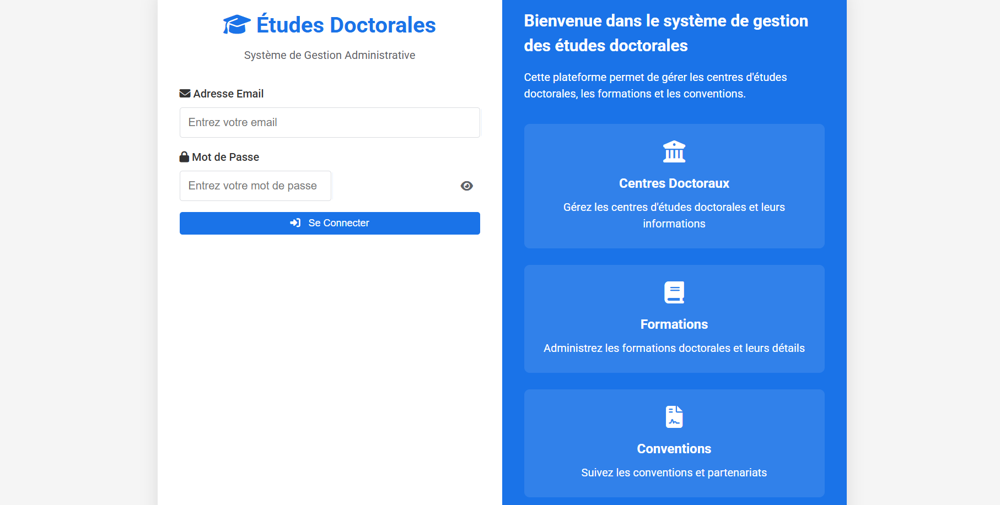
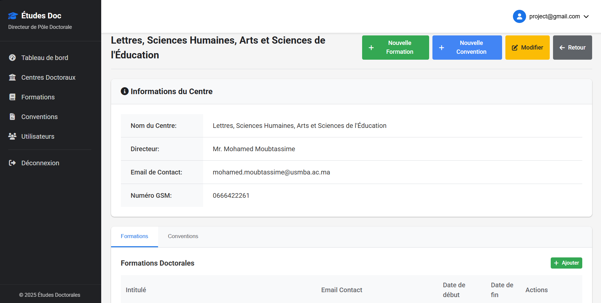
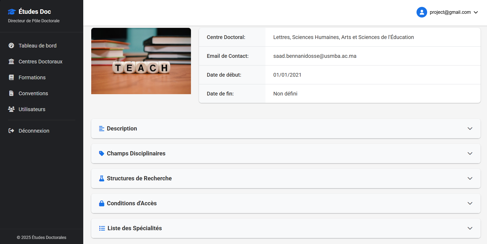
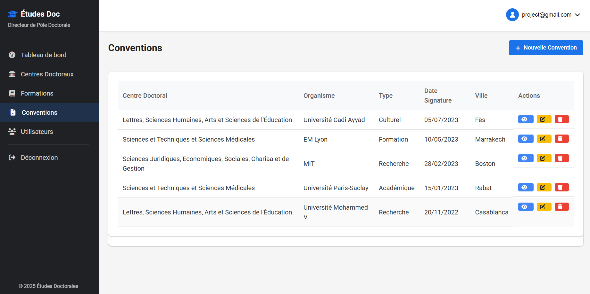

# Conception et Développement d'une Plateforme Web Dynamique et Sécurisée pour la Gestion des Informations du Pôle des Études Doctorales

Plateforme web dynamique destinée au Pôle des Études Doctorales de l'Université Sidi Mohamed Ben Abdellah de Fès.

L'objectif principal est de remplacer l'ancien site web statique par une application web moderne, dynamique et sécurisée permettant de centraliser, organiser et gérer les différentes informations relatives aux études doctorales.

La plateforme permet aux administrateurs de gérer les données et aux directeurs du Pôle des Études Doctorales de consulter et de suivre les informations disponibles.

## Captures d'écran

### Page de Connexion

### Tableau de bord

### Centres Doctoraux

### Détails d'un Centre

### Formations Doctorales

### Détails d'une Formation

### Conventions

### Détails d'une Convention

### Gestion des Utilisateurs

### Informations de l'utilisateur

## Objectifs du projet

- Moderniser le système existant de gestion des informations.
- Centraliser les données relatives aux études doctorales.
- Faciliter la gestion et la mise à jour des informations.
- Sécuriser l'accès à la plateforme grâce à un système d'authentification et de gestion des rôles.
- Améliorer l'accessibilité et la consultation des informations.

## Fonctionnalités principales

- **Authentification et gestion des utilisateurs.**
- **Gestion des rôles et des autorisations :** Directeur et Admin CED.
- **Gestion des Centres Doctoraux :** Ajout, modification, suppression et consultation.
- **Gestion des Formations Doctorales :** Ajout, modification, suppression et consultation.
- **Gestion des Conventions.**
- **Gestion des Spécialités.**
- **Tableau de bord** avec statistiques : Centres, Formations, Conventions, Spécialités.
- **Interface d'administration** pour faciliter la gestion du contenu.
- Consultation des données centralisées.

## Gestion des Rôles

| Rôle | Accès |
| --- | --- |
| **Directeur** | Accès complet, gestion des utilisateurs, consultation de toutes les données |
| **Admin CED** | Gestion de son Centre Doctoral, ses Formations et ses Conventions |

## Technologies utilisées

- **Backend :** PHP
- **Frontend :** HTML, CSS, JavaScript, Bootstrap
- **Base de données :** MySQL
- **Environnement de développement :** XAMPP

## Installation

1. Copier le projet dans `C:\xampp\htdocs\project`
2. Démarrer `Apache` et `MySQL` dans XAMPP
3. Aller sur `http://localhost/phpmyadmin`
4. Créer une base de données nommée `etudedoc`
5. Importer le fichier `etudedoc.sql` qui se trouve à la racine du projet
6. Aller sur `http://localhost/project`

## Compte Démo

Pour tester la plateforme :

Email : project@gmail.com
Mot de passe : fatima2003
Rôle : Directeur

## Structure du projet

project/
├── admin/
├── assets/
├── includes/
├── screenshots/
├── uploads/
├── centers.php
├── formations.php
├── conventions.php
├── users.php
├── dashboard.php
├── index.php
└── etudedoc.sql

## Auteur

**Fatimazahrae Elatoui** - Projet de Fin d'Études
Université Sidi Mohamed Ben Abdellah - Fès
